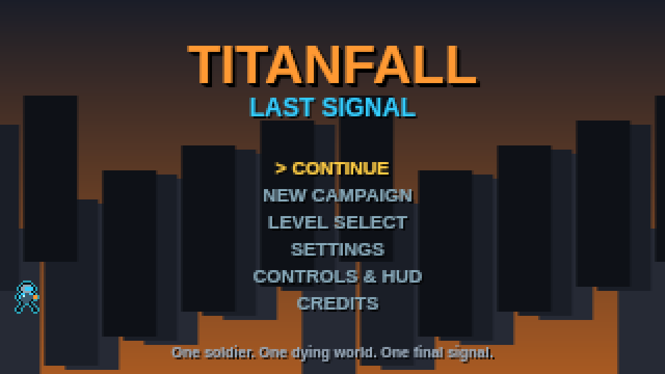
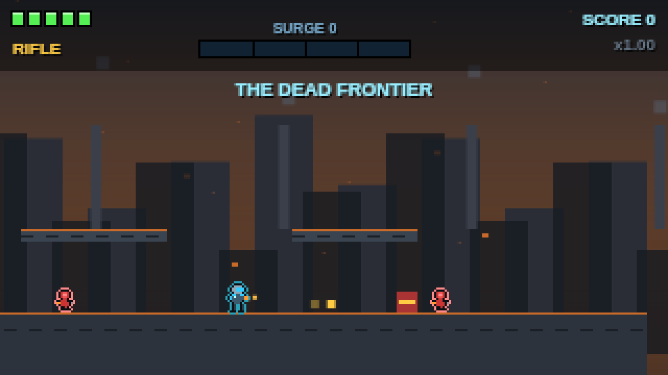
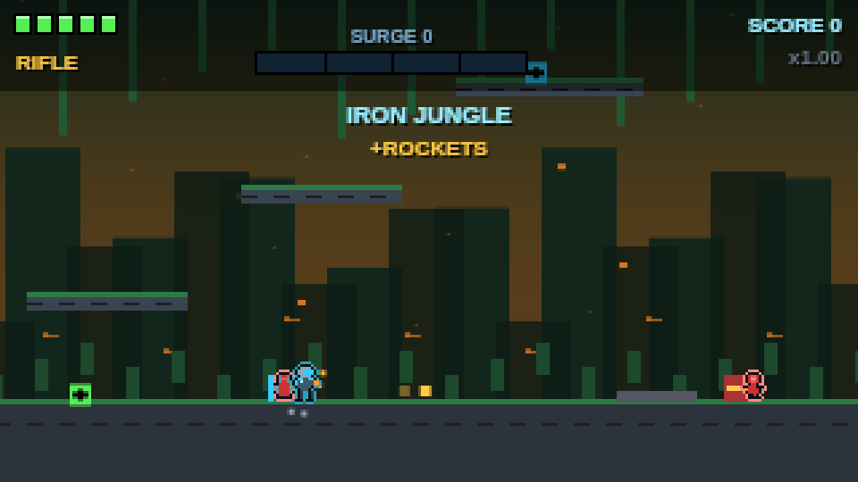
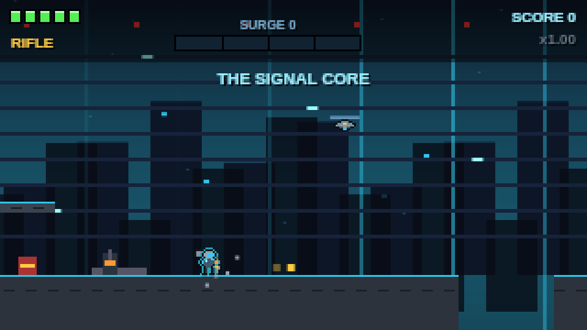
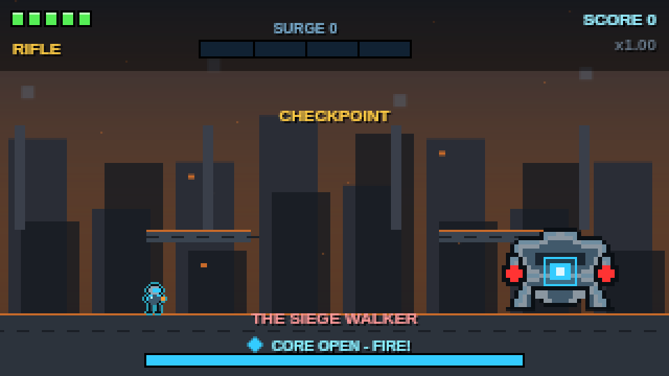
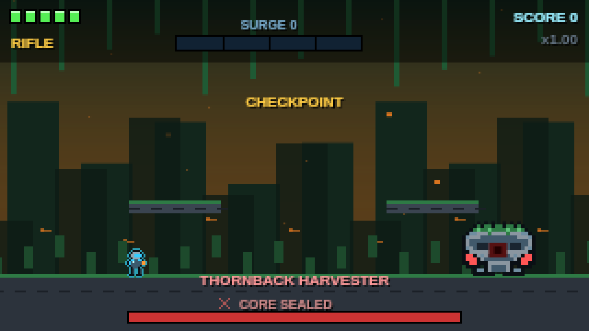
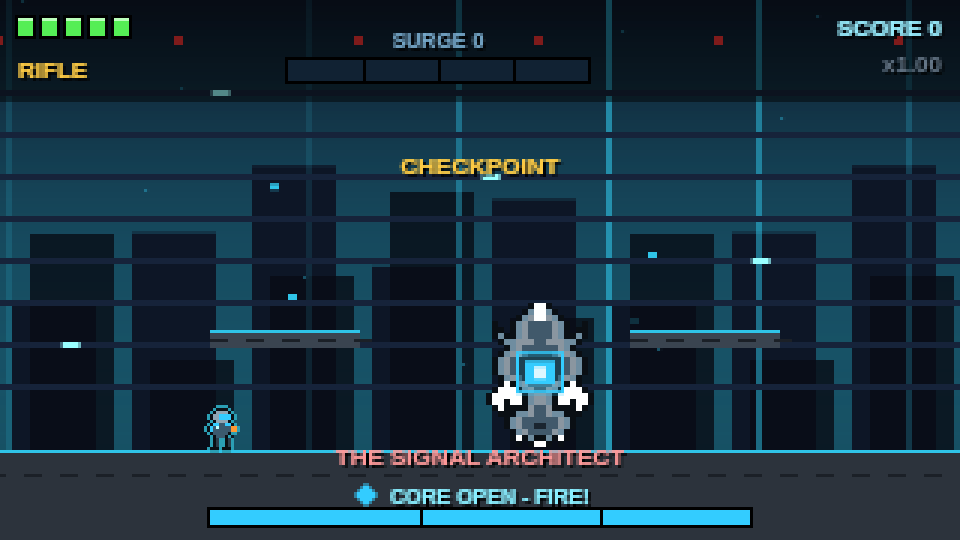

# TITANFALL: LAST SIGNAL

> *One soldier. One dying world. One final signal.*

A three-level pixel-art run-and-gun for the browser, written as **one self-contained `index.html`**: no build step, no external assets, no backend. Play it on desktop or on a phone.



## Story
Year 2197. The colony Eos-9 has gone silent and its defense network has been hijacked. You are **Rook**, sent to cross the occupied city, the overgrown weapons zone and the underground facility where the last signal originates.

## Features
- **3 levels:** The Dead Frontier, Iron Jungle, The Signal Core
- **3 bosses:** Siege Walker, Thornback Harvester (miniboss), Signal Architect (three phases)
- **4 weapons:** Rifle, Scatter Cannon, Railgun (piercing), Rocket Launcher (area damage, limited ammo)
- **5 enemy types:** Infantry, Shield unit, Turret, Drone, Heavy elite
- **Signal Surge** energy pulse, **combo** scoring, mission grades, upgrades earned from data cores
- Checkpoints, secret rooms (lever + hidden stairs), moving platforms, hazards, explosive barrels
- Fully generated **pixel art** and **audio** (layered music per level, synthesized effects)
- **PC:** remappable keys, HUD options, fullscreen. **Mobile:** virtual stick, multi-touch buttons, left-handed mode, size/opacity settings, optional auto-fire
- Local saves (progress, best results, settings, key bindings)

| | | |
|---|---|---|
|  |  |  |
|  |  |  |

> Screenshots are rendered from the real game code by `npm run screenshots` using a headless canvas, not a browser.

## Controls
| Action | PC (defaults, remappable) | Mobile |
|---|---|---|
| Move | A / D or arrows | Left stick |
| Jump | Space | JUMP |
| Fire | J or mouse | FIRE |
| Aim up | W | Push stick up |
| Switch weapon | K | SWAP |
| Signal Surge | Q | SURGE |
| Interact | E | E |
| Pause | Esc | II |
| Fullscreen / reduced effects | F / V | Settings |

## Run locally
```bash
git clone https://github.com/<your-username>/titanfall-last-signal.git
cd titanfall-last-signal
npm install        # only needed for tests and screenshots
npm start          # serves http://localhost:3000
```
You can also just open `index.html` in a browser.

## Test
```bash
npm test
```
Runs 216 headless checks (combat, Surge, combo, bosses, saves, progression, touch input, key rebinding, layout, audio scheduling). See [docs/TESTING.md](docs/TESTING.md) for what is and is not covered.


## Project structure
```
index.html        the whole game (HTML + CSS + JS)
tests/            headless test suites and the harness that runs index.html in Node
tools/            screenshot generator
docs/             architecture, testing, assets, roadmap
assets/           generated screenshots only (game art is generated in code)
.github/          CI workflow, issue and PR templates
```

## Saves
Progress is stored in the browser's `localStorage` (key `tfl1`). Saves are validated on load, and corrupt data falls back to safe defaults. They do **not** sync between devices or browsers.

## Status and known limitations
Be aware before you judge it:
- **Not yet tested on real devices.** All verification so far is headless: logic tests, simulated multi-touch, and screenshots from a Node canvas. Real-phone feel, real audio, and real-browser performance are unverified.
- **Boss balance is untuned.** Each boss was killed by a bot, not played by humans. Difficulty and fairness need playtesting.
- Art is low-resolution pixel maps with few animation frames; audio is synthesized.
- No frame-rate measurements have been made.

See [docs/ROADMAP.md](docs/ROADMAP.md). Bug reports and playtest feedback are welcome via the issue templates.

## License
MIT, see [LICENSE](LICENSE). All art, music and code are original; there are no third-party assets (see [docs/ASSETS.md](docs/ASSETS.md)).
